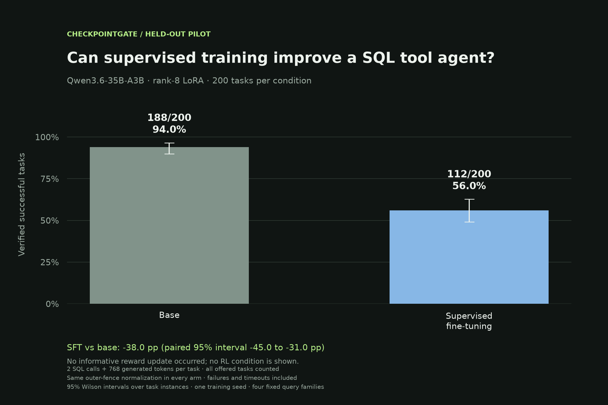

# CheckpointGate

A verifier-driven SQL agent experiment with Baseten Loops and a Cloudflare evidence layer.

**First real pilot complete: SFT reduced held-out SQL accuracy from 94% to 56%.** The trained checkpoint eliminated strict-format violations but regressed on latest-row and NULL-safe anti-join tasks. All 18 sampled reward groups had equal rewards, so no RL update occurred. The results site is deployed on Cloudflare Workers; R2 activation, the production evidence API, and invoice reconciliation remain pending.

**[Open the results and all held-out traces](https://checkpoint-gate-results.zeeshan8281.workers.dev)**



The comparison uses 200 identical held-out tasks per condition, one training seed, rank-8 LoRA, 12 supervised updates, and 96 assistant-turn demonstrations. SFT versus base: **−38 percentage points**, paired task-level 95% interval **−45 to −31 points**. The elementary format/arithmetic/copy suite scored 54/100 after SFT versus 68/100 for base; it is not a broad forgetting benchmark.

[Full results](evidence/pilot-seed7/RESULTS.md) · [SQL error analysis](evidence/pilot-seed7/ERROR_ANALYSIS.md) · [Raw task traces](evidence/pilot-seed7/) · [Adapter export metadata](evidence/adapter-export.json)

The complete pilot made 1,387 sampling requests and reserved $0.871654 at the configured conservative rates. Two earlier dev smokes add $0.017852, for **$0.889506 in total reservations, not an invoice**. The training run and samplers were confirmed inactive after cleanup. This is a negative result on a small synthetic distribution; no general improvement or novel algorithm is claimed.

The research question: **does supervised fine-tuning followed by deterministic reward training improve completion on unfamiliar SQL query families, within the same tool and token budget?**

## What is implemented

- 600 reproducible synthetic tasks: 200 training, 200 development, 200 held-out tests. Query construction families and schema vocabulary are disjoint across splits.
- A read-only SQLite tool with authorizer restrictions, a function allowlist, execution limits, and bounded results.
- Multi-turn SQL rollouts, deterministic result verification, transient fault injection, and training demonstrations.
- Native `baseten-loops==0.36.0` integration for SFT, group-centered `cispo` reward updates, saved optimizer state, and checkpoint-pinned sampling.
- Pre-dispatch token/dollar reservations in a durable SQLite ledger. A timeout or ambiguous operation retains its reservation and stops the campaign.
- Cloudflare Durable Object leases with fencing tokens, immutable receipts, and content-addressed evidence in R2.
- Paired test comparisons, task-level confidence intervals, a separate 100-case elementary format/arithmetic regression suite, and a trace replay UI.
- Tests that cover adversarial SQL, ambiguous remote outcomes, concurrency, SDK data contracts, the complete controller with a fake service, and the actual local Cloudflare runtime.

This is a synthetic pilot, not a validated general SQL benchmark or evidence of a novel training algorithm.

## Run locally without accounts

Python 3.12+:

```bash
python3.12 -m venv .venv
source .venv/bin/activate
pip install -e .
python -m unittest discover -s tests -v

checkpoint-gate generate --out data/pilot --per-family 50
checkpoint-gate demo --data data/pilot --out runs/local-demo
cp runs/local-demo/demo.json web/demo.json
python -m http.server 8080 --bind 127.0.0.1 --directory web
```

Open [the real-results dashboard](http://localhost:8080) or [the separate scripted self-test](http://localhost:8080/self-test.html). The committed demo was generated with these commands. A dataset directory cannot be overwritten; its manifest hashes every database and the task/gold files.

The scripted no-retry agent passes the 100 clean test cases and fails the 100 injected-error cases. The scripted retry agent passes all 200. These expected results validate fault plumbing and scoring. **They are not model performance.** The initial real dev smoke separately exposed a Markdown-fence confound; protocol version 2 normalizes one outer fence equally for all conditions and records strict-format violations separately.

## Baseten setup and read-only check

1. Use a Baseten workspace with Loops access. A regular dashboard account alone does not establish serverless Loops entitlement.
2. Create an appropriate workspace API key in [Baseten API keys](https://app.baseten.co/settings/api_keys). Keep it out of source control and chat.
3. Set `BASETEN_API_KEY` in the shell that will run the experiment. Install the audited SDK:

```bash
pip install -e '.[baseten]'
checkpoint-gate preflight --config configs/pilot.json --out runs/capabilities.json
```

`preflight` performs one authenticated GET to `/v1/loops/capabilities`. It does not create an SDK session, trainer, sampler, or deployment. It requires `enabled=true`, `serverless=true`, and sufficient enabled sequence length. Rank validation happens on creation; the explicit serverless scope prevents dedicated fallback.

Model: **Qwen/Qwen3.6-35B-A3B, 35B total / 3B active**, rank-8 LoRA. Baseten hosts the heavy forward/backward and sampling work. This Mac handles the verifier, data, coordination, and analysis.

Before training, exercise the real base sampler on eight development tasks:

```bash
checkpoint-gate smoke --data data/pilot --out runs/dev-smoke \
  --config configs/pilot.json --execute-paid-run
```

The smoke test has a separate $0.25 reservation ceiling and a 15-minute dispatch window. It performs no training. Count its spend toward the overall project budget; one smoke plus the configured pilot has a $23.25 maximum planning allocation.

## Execute the paid pilot

Review the rates in `configs/pilot.json` against current account pricing first.

```bash
checkpoint-gate run \
  --config configs/pilot.json \
  --data data/pilot \
  --out runs/pilot-seed7 \
  --execute-paid-run
```

The command checks access before creating the output directory. It then runs an eight-task dev calibration, SFT, bounded reward groups, and a frozen held-out evaluation of the base and final checkpoints. A near-ceiling dev baseline stops the run before training. If no reward group has differing scores, it reports that no RL update occurred and evaluates only base/SFT.

There is no automatic restart of a stopped paid campaign. Existing output directories are refused. Do not work around a stop by picking a new directory: inspect reservations and reconcile remote operations first. Saved `weights/` checkpoints contain optimizer state and can be restored through Baseten's documented `load_state_with_optimizer`; implementing an audited automatic resume controller is follow-up work.

No dedicated inference endpoint is created. Cleanup deactivates runs and standalone samplers created in this session. Check `shutdown.json`; a failed deactivation is reported rather than treated as confirmed.

### Budget

| Allocation | Ceiling |
| --- | ---: |
| Compute reservations | $10 |
| Optional Cloudflare plan | $5 |
| Contingency | $4 |
| Tax/FX buffer | $4 |
| Total planning allocation | **$23** |

Additional ceilings: 4M training tokens, 1M uncached-prefill tokens, 1M sampled tokens, and a four-hour dispatch window. In-flight requests and cleanup can extend beyond the dispatch window. Each request has its own timeout.

Rates are the inspected 19 November 2026 promotional rates multiplied by 1.25 as a planning margin, **not a quote or billing guarantee**. The ledger counts full training sequences, full prompts, and the maximum possible generated tokens. Successful reservations stay consumed; unused generation allowance is not recycled. Pricing changes, taxes, unrelated account use, and metering discrepancies must be reconciled against the provider invoice. Baseten dashboard budgets do not enforce training spending.

The local ledger is the only spending authority. Do not run copies of the campaign from multiple machines or delete its ledger. Cloudflare leases coordinate evidence ownership; they do not create globally exactly-once model execution or a global billing cap.

## Cloudflare control layer

The public results site uses the separate static-only configuration below. It
does not provision R2, Durable Objects, or an API, and does not require an R2
subscription:

```bash
cd worker
npm ci
npx wrangler deploy --config wrangler.site.toml
```

The full evidence backend uses `worker/wrangler.toml` and the setup below.
These are separate Workers, so updating the static site does not alter the
evidence service. R2's usage-based subscription requires separate activation;
do not treat its free allowance as an enforced billing cap.

Node 22+:

```bash
cd worker
npm ci
npm test
npm run check
```

For local integration, put a **local-only** secret of at least 24 characters in `worker/.dev.vars`:

```text
CONTROL_TOKEN=your-local-test-secret-at-least-24-characters
```

Then:

```bash
npm run dev
# In another terminal, set CHECKPOINT_GATE_TOKEN to the same local secret:
node test/integration.mjs
```

This tests the real local workerd runtime, SQLite Durable Objects, and R2 emulation. It does not require a Cloudflare account.

For a cloud deployment, authenticate Wrangler, create the R2 bucket named in `wrangler.toml`, set `CONTROL_TOKEN` with `wrangler secret put CONTROL_TOKEN`, and deploy. These are explicit setup steps; the Python runner never provisions Cloudflare resources.

The public site displays the exported real pilot and all held-out traces. `self-test.html` separately shows scripted infrastructure checks. All `/api/` routes require the secret. Publishing completed results is an explicit export step; private campaigns are not automatically added to the public site.

To mirror a paid run:

```bash
checkpoint-gate run --data data/pilot --out runs/pilot-seed7 \
  --config configs/pilot.json --cloud-url https://YOUR-WORKER.workers.dev \
  --execute-paid-run
```

Set `CHECKPOINT_GATE_TOKEN` to the deployed Worker secret. The runner renews its lease before remote operations; evidence writes verify the fencing token both before upload and at receipt commit.

API routes:

| Method / path suffix | Behavior |
| --- | --- |
| `POST /api/campaigns/:id/init` | Freeze a campaign manifest; reject conflicting reinitialization |
| `POST /api/campaigns/:id/lease` | Acquire or renew a 10-minute lease |
| `POST /api/campaigns/:id/receipt` | Validate SHA-256, store in R2, commit immutable receipt |
| `GET /api/campaigns/:id/status` | Return manifest, lease, and evidence references |

Evidence can be retrieved with the authenticated R2 tooling using the returned object key. There is no public results download endpoint.

## Inspect and reproduce the published analysis

The training code was frozen at commit `768b0171ca9e7eee815652ae1b532f17542709e5`.
Its file hashes, checkpoint references, operation reservations, raw reward samples,
and all offered test traces are retained in `evidence/pilot-seed7/`.
See [analysis instructions](analysis/README.md) to export a completed run, render the
graph, and inspect a live run through read-only SQLite.

The downloaded sampler adapter contains 140,381,184 parameters in 862 BF16 tensors.
Its hashes and configuration metadata are published; the 281 MB weight file is
kept separately from Git. Compatibility with MLX or another inference engine has
not been tested. The provider did not expose an immutable digest of its loaded
base weights.

## Source map

| Module | Responsibility |
| --- | --- |
| `dataset.py` | Frozen tasks, database generation, gold separation |
| `verifier.py` | Restricted SQLite execution, strict actions, semantic rows |
| `rollout.py` | Tool protocol, demonstrations, bounded multi-turn execution |
| `ledger.py` | Reservation state machine and limits |
| `baseten_backend.py` | Native SDK operations and operation/checkpoint receipts |
| `campaign.py` | Calibration, SFT, reward groups, evaluation, cleanup |
| `evaluation.py` | Primary metrics and paired uncertainty |
| `cloud.py` / `worker/` | Leases and evidence mirroring |
| `web/` | Scripted trace replay |

See [PROTOCOL.md](PROTOCOL.md) for interpretation limits, [SOURCES.md](SOURCES.md) for implementation references, and [evidence/VALIDATION.json](evidence/VALIDATION.json) for what was actually tested.
