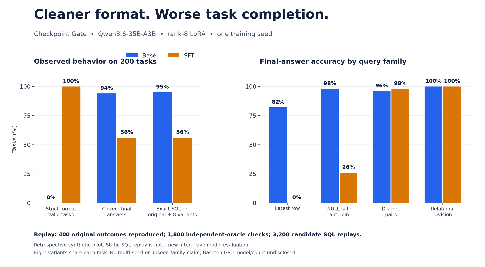

# Checkpoint Gate study package

**Completed:** a single-seed model experiment and a retrospective SQL replay.
**Pending:** the fresh three-seed replication in `protocol.json`.

Read [the full study](STUDY.md), [the prospective plan](PROSPECTIVE.md), and [the source catalog](SOURCES.md).



## Reproduce the completed replay

From the repository root, using Python 3.12:

```bash
python -m venv .venv
source .venv/bin/activate
pip install -e .
python -m checkpoint_gate.cli generate --out data/replay-pilot --per-family 50 --seed 20261119
python -m unittest discover -s study -p 'test_*.py' -v
python study/audit.py --data data/replay-pilot \
  --out runs/replay-study --scratch runs/replay-databases
```

The replay validates the generated dataset against the preserved pilot manifest. It refuses to overwrite an output directory and performs no network or model operations. `study/results/replay-v1` retains the measured release results.

For graphs:

```bash
pip install -r analysis/requirements.txt
python study/plot.py --results study/results/replay-v1 --out runs/study-figures
```

For a new prospective input bundle:

```bash
python study/prepare.py --out runs/prospective-new
```

This creates new private data and a new commitment. It does not reproduce the unreleased private future dataset and does not execute training. Keep future test inputs private until the planned evaluation is finished.

## Files and interpretation

- `STUDY.md`: methods, results, prior work, and limitations.
- `results/replay-v1/summary.json`: measured aggregate results, source hashes, and check counts.
- `results/replay-v1/task-audit.json`: all 400 task-arm diagnostics.
- `results/replay-v1/variant-results.json`: all 3,200 candidate-query replay outcomes.
- `figures/study-overview.png` and `.svg`: one graph for sharing, generated from measured results.
- `protocol.json` and `prospective-commitment.json`: future protocol and public input hashes.
- `research/`: three independently researched tracks, source evidence, and explicit uncertainties.

The repository's MIT license covers the project code. Upstream model weights are not redistributed here. Linked papers and documentation retain their publishers' terms; the release contains citations and research notes, not copies of their full texts. This study contains generated synthetic task data, not private customer data.
