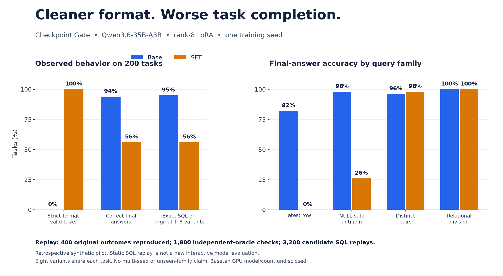

# Cleaner Format, Worse Task Completion

## A small-data LoRA case study of a SQL tool-using model

**Author:** Zeeshan
**Version:** 1.0, 20 November 2026
**Status:** Completed single-seed pilot plus retrospective SQL replay. The three-seed prospective follow-up is planned, not executed. This report has not undergone external peer review.

## Abstract

We study the distinction between output-format compliance and verified task completion after small-data supervised fine-tuning. A Qwen/Qwen3.6-35B-A3B model received rank-8 LoRA training through Baseten Loops: 12 optimizer updates using 96 conditional assistant-turn demonstrations. On 200 identical synthetic SQL tasks, base-model accuracy was 188/200 (94%) and the final SFT checkpoint scored 112/200 (56%). All 200 SFT traces complied with the strict action format, while every base trace contained at least one format violation handled by the common, predeclared outer-fence normalization. The paired accuracy change was −38 percentage points.

We independently rescored all 400 recorded outcomes and replayed each final successful SQL query against its original database and eight deterministic variants. An independent Python oracle checked the reference SQL on all 1,800 databases. Of the SFT model's 88 failed tasks, 87 had an inexact final query result; one had an exact query result but an incorrect final answer. The finite replay suite exposed no additional failures among queries already exact on their original database. These findings locate the observed regression mainly in query-result adequacy on two fixed task families, while leaving its training mechanism unresolved.

The result is conditional on one fitted seed, one model, and a narrow synthetic distribution. It is not evidence that LoRA generally degrades models, that broad catastrophic forgetting occurred, or that a novel checkpoint-selection algorithm has been validated. The provider's physical GPU model and count were not disclosed in the retrieved customer-visible records.

## 1. Questions and evidence boundaries

The completed pilot asks whether the fixed SFT recipe changes verified completion under a shared tool and output-token budget. The retrospective analysis asks where incorrect final answers occur relative to the last successful query, and whether standalone query results survive controlled data changes.

The original pilot protocol preceded its held-out model evaluation. The replay suite and this report were designed **after** the pilot results were known. The replay is therefore exploratory. The original public test cannot be reused to tune a replacement checkpoint and then described as fresh confirmation.

There are three distinct evidence classes:

| Component | Status | What it establishes |
| --- | --- | --- |
| Base versus final SFT, 200 paired tasks | Completed remote model experiment | Observed completion and format differences for this fitted run |
| Original-data checks and eight-variant SQL replay | Completed local computation; zero new model calls | Reproducibility and finite standalone-query behavior |
| Fresh inputs, three seeds, paired schedule | Frozen plan; not executed | A prospective commitment, with no performance result yet |

## 2. Experimental setup

### Model and training

The model identifier was `Qwen/Qwen3.6-35B-A3B`; the provider performed training and sampling through Baseten Loops serverless. The Mac performed orchestration and SQLite verification. Rank was 8, learning rate `4e-5`, batch size eight conditional assistant turns, and training length 12 updates. The 96 consumed turns came from 83 distinct training tasks. The training seed was 7.

A conditional turn retains the complete preceding conversation. The implementation flattens these turns and shuffles them before choosing the training subset. This creates a coverage and weighting question; it does **not** by itself establish malformed or context-free demonstrations. Prompt targets are masked. The static next-token shift is consistent with autoregressive training, but exact provider loss reduction and all tokenizer/end-of-turn semantics need further integration checks.

The final SFT checkpoint was prescribed rather than selected by test accuracy. The provider's immutable loaded base-weight digest was unavailable. The saved sampler adapter contains 140,381,184 parameters in 862 BF16 tensors; an adapter export does not establish portability to another engine.

### Tasks and tools

The generator contains 200 training, 200 development, and 200 test instances. Construction families and vocabulary differ across splits, but every task uses a related two-table schema. The test set has 50 instances from each of four templates: latest row per parent, NULL-safe anti-join, distinct joined pairs, and relational division.

Half of each family has a deterministic transient error on the first tool call. All arms share two SQL calls, 768 total generated tokens, at most 384 generated tokens per turn, evaluation temperature zero, and a 4,096-token sequence ceiling.

An action is one JSON object containing `sql` or `answer`. The evaluator removes one complete outer plain/JSON Markdown fence identically for both arms; it does not repair SQL. A final answer must match trusted rows, preserving column order, SQL NULL values and duplicate multiplicity. Row order is enforced when the question requests it. A successful query is required before a final answer is accepted.

### Statistical target

The primary reported effect is the paired change in task accuracy on this fixed distribution. There were 78 base-to-SFT regressions, two improvements, and 120 ties. The original unstratified task-bootstrap 95% interval was **−45 to −31 percentage points**. It is retained as the pilot's original analysis.

As a retrospective sensitivity analysis, 10,000 paired bootstrap draws stratified by the eight fixed family-by-fault cells yield **−42.5 to −33.5 points**. This different interval holds cell counts fixed; it does not replace the original interval or establish greater generalizability. Neither interval estimates uncertainty over new families, new training seeds, or provider infrastructure. Tiny task-level paired p-values would not remove these limitations.

## 3. Results

| Measure | Base | Final SFT |
| --- | ---: | ---: |
| Correct final answer | 188/200 | 112/200 |
| Entire trace valid under strict parser | 0/200 | 200/200 |
| Last successful SQL exactly returns expected rows, original DB | 190/200 | 112/200 |
| Last SQL exact on original DB and all eight variants | 190/200 | 112/200 |
| Original final answer correct **and** last SQL survives suite | 188/200 | 111/200 |

Strict-format validity is task-level here: **every assistant turn** must pass without normalization. The original pilot also reports turn-level format violations, 296 for base and zero for SFT. A Markdown-wrapped JSON object can fail this strict metric while still yielding a correct task result under the common normalization.

| Query family | Base final answer | SFT final answer |
| --- | ---: | ---: |
| Latest row per parent | 41/50 | 0/50 |
| NULL-safe anti-join | 49/50 | 13/50 |
| Distinct joined pairs | 48/50 | 49/50 |
| Relational division | 50/50 | 50/50 |

The published trace examples show two concrete patterns: selecting high IDs rather than the latest timestamp with an ID tiebreak, and filtering away closed child rows before an aggregate tests whether any closed rows exist. These examples motivate mechanisms to test; the report does not claim that every erroneous query has been manually classified.

### Query versus final-answer failures

| Failed historical tasks | Base | SFT |
| --- | ---: | ---: |
| Wrong final answer and inexact last query result | 10 | 87 |
| Wrong final answer despite exact last query result | 2 | 1 |
| Total failed tasks | 12 | 88 |

“Inexact query” is a diagnostic of its standalone output. An agent can intentionally retrieve extra rows and compute the final answer afterward. Indeed, one successful SFT task had an inexact standalone last query. Therefore, replacing every final answer with tool rows is not justified by these data.

## 4. Retrospective static SQL experiment

For each of the 200 test tasks, `audit.py`:

1. Verifies the frozen dataset hash and unique paired task IDs.
2. Rescores each recorded final answer and checks the result against the original outcome.
3. Re-executes the final successful SQL on the original database and checks its rows against the recorded tool response.
4. Generates eight deterministic databases without changing the schema or question.
5. Checks the gold SQL against a separately written Python oracle.
6. Runs each saved candidate SQL on every variant and records exactness, errors, expected rows, actual rows, and database hashes.

Variants randomize row data and include explicit timestamp/ID disagreements, timestamp ties, mixed open/closed labels, duplicate logical events, NULLs, and an empty parent. No variant is selected based on which arm passes it. Variant seeds derive from task identity and variant index.

The run verified **400 final outcomes**, **400 original tool responses**, **1,800 gold-SQL/Python-oracle comparisons**, and **3,200 candidate-query replays**. Seven focused tests exercise the oracle, NULL/mixed-label cases, timestamp tie-breaking, final-answer rescoring, intentional postprocessing, score tampering, and paired inference.

All originally exact base queries (190) and originally exact SFT queries (112) survived the tested variants. Among the 110 tasks originally completed correctly by both models, the static suite passed 110 base queries and 109 SFT queries. The missing SFT case is consistent with the distinction between standalone SQL and agent postprocessing.

This finite suite found no additional counterexample among original-exact queries. Passing eight variants does not prove semantic equivalence. The variants are clustered within their original task and are not 1,600 independent tasks per arm. This is also not an interactive evaluation on altered tool feedback: no model saw the variants.

## 5. Why the reward stage made no updates

After SFT, the pilot sampled 18 groups of four trajectories from the training distribution. All 72 trajectories succeeded, with identical rewards within each group. Group-centered advantages were therefore zero; the controller skipped every group and performed **zero RL updates**.

The result identifies a difficulty mismatch in the sampled reward tasks. It is neither an RL success nor evidence that RL cannot address these failures. The next primary study excludes RL so that a direct SFT replication can be interpreted cleanly. A later RL study needs a separately frozen training-only difficulty and informative-group pilot, with bounded sampling.

## 6. Relation to prior work

LoRA [1] defines the low-rank intervention. LIMA [2] motivates separating changes in response style from broader capability. “LoRA Learns Less and Forgets Less” [3] measures retention tradeoffs under different settings; it does not establish the mechanism of this Qwen result. Standard chat-template and supervised-loss documentation [4,5] motivates explicit token/mask audits rather than assuming a tokenizer bug.

Query-based split methodology [6] explains why changing schema names alone is insufficient evidence of SQL generalization. Distilled SQL test suites [7] directly precede the static replay idea. Our eight deterministic variants are a small diagnostic suite, not that paper's suite-distillation algorithm.

Paired NLP testing [8], benchmark variance [9], and model-selection bias [10] support matched tasks, explicit uncertainty, repeated fitted seeds, and untouched test evaluation. Ordinary validation checkpoint selection is established practice. “Checkpoint Gate” names an engineering artifact; this release does not claim a new selection algorithm.

The accompanying [source catalog](SOURCES.md) deduplicates the three research tracks. It distinguishes substantive papers from first-party software and pricing documentation, records inspection depth, and preserves uncertainty and access failures.

## 7. Hardware, accounting, and reproducibility

The recorded run was Baseten `w67255q`, with base sampler `wl1v8vq` and trained sampler `wpj169w`. The API returned null deployment and instance-type fields. The dashboard labels the run serverless. Baseten support ticket #44313 was submitted to request historical hardware identification; no human hardware confirmation has been verified for this release.

The first-to-last dispatch span was **64m14.491s**. This is a wall-clock request span, including orchestration and remote service effects, not measured GPU execution time. No GPU-hours, accelerator speedup, or hardware-normalized efficiency is reported.

The pilot and prior smokes reserved **$0.889506** under configured conservative token rates. This is not a reconciled invoice. The replay added zero model calls and zero cloud charges. Current public prices cannot establish historical bills.

Frozen original evidence is retained separately from this new analysis. The release includes source code, raw pilot traces, task-level audit rows, variant outcomes, hashes, the original protocol, this report, and a future protocol commitment. The original source commit was `768b0171ca9e7eee815652ae1b532f17542709e5`; later UI publication used `5e1610a2f30ca28066fa0f071d310a53d6135845`.

## 8. Prospective follow-up and release scope

The next fixed study is defined in [protocol.json](protocol.json) and [PROSPECTIVE.md](PROSPECTIVE.md): three new training seeds, the original fixed SFT recipe, fresh private instances of the same four known test families, 80 development and 200 test tasks, base/SFT pairs, and 1,680 planned task episodes. It records selection rules before test access and requires hardware and billing checks before measured paid work. Its inputs have been frozen; **it has not run**.

Fresh instances will test repeatability within known families, not unseen-family generalization. Three seeds are a minimum replication exercise, not a universal power guarantee. Broader schemas, independent query families, other models, training doses, and retained-capability suites remain future work.

The defensible release claim is: **in this single-seed synthetic SQL pilot, strict format compliance improved while verified completion fell sharply; a reproducible retrospective replay places most failures alongside inadequate query results.** The cause and the generality of that regression remain open.

## References

1. Hu et al. [LoRA: Low-Rank Adaptation of Large Language Models](https://arxiv.org/abs/2106.09685).
2. Zhou et al. [LIMA: Less Is More for Alignment](https://arxiv.org/abs/2305.11206).
3. Biderman et al. [LoRA Learns Less and Forgets Less](https://arxiv.org/abs/2405.09673).
4. Hugging Face. [Chat templates](https://huggingface.co/docs/transformers/chat_templating).
5. Hugging Face. [SFT Trainer](https://huggingface.co/docs/trl/sft_trainer).
6. Finegan-Dollak et al. [Improving Text-to-SQL Evaluation Methodology](https://aclanthology.org/P18-1033/).
7. Zhong et al. [Semantic Evaluation for Text-to-SQL with Distilled Test Suites](https://aclanthology.org/2020.emnlp-main.29/).
8. Dror et al. [The Hitchhiker's Guide to Testing Statistical Significance in Natural Language Processing](https://aclanthology.org/P18-1128/).
9. Bouthillier et al. [Accounting for Variance in Machine Learning Benchmarks](https://arxiv.org/abs/2103.03098).
10. Cawley and Talbot. [On Over-fitting in Model Selection and Subsequent Selection Bias in Performance Evaluation](https://jmlr.org/papers/v11/cawley10a.html).
